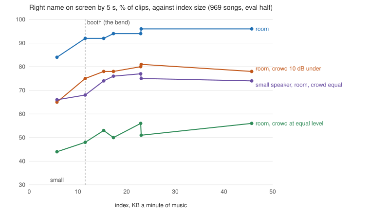

# W5. A name by five seconds: where the time goes, what size buys, what the listener buys

Branch `recog/fast`. This letter follows W4 (`w4-recognition-complete.md`), which describes the fingerprint, the
index and the listener. Nothing here changes a default; the owner chooses.

**Words used.** A *fingerprint* is the small file of a song's loudest points in time and pitch that Desk writes
into the crate file. The *index* is the table Booth builds from the fingerprints so that a few seconds of sound can
be looked up. The *listener* is the code that takes microphone sound and gives a *reading* once a second: a song,
the place in it, the fader (speed in percent) and how sure it is. A *hard cut* is one song stopping and another
starting at once; a *blend* is one fading in over another. *dB* (decibel) is the measure of loudness: 10 dB under
is about half as loud to the ear. The *dev half* and *eval half* are two separate halves of an outside set of 969
songs: anything chosen by measurement is chosen on dev and reported on eval.

## 1. The answer

- **In a clean or quiet room the name is already up at 3 s** for half the clips and by 5 s for 9 in 10. The
  8 s in the first letters was the length of sound a search uses, not the wait.
- **The slow cases were two, and neither is the size of the index.** After a hard cut the old name stayed 4 s and
  the new one came at 5 s; in a loud crowd half the clips take 6 s or more.
- **The first is fixed in the listener**: with the fast setting the new song is named 3 s after a cut (was 5),
  the old name is gone by then, and in a blend the name changes 2 to 3 s after the two songs are equally loud (was
  5). Wrong names did not rise.
- **The second is not fixed by anything tried.** A crowd as loud as the music still names 48 in 100 clips by 5 s.
  Four times the index does not change that; lower bars and fuzzy lookup buy 3 to 5 points and each has a cost.
- **A larger index is not worth it.** The bend in the size curve is at `booth` (section 3).
- **Recommended**: `boothFast` (= `booth`'s index with the fast listener). The default is left alone.

| Setting | Index | Clean | Room | Crowd 10 dB under | Crowd equal | Crowd 5 dB over | Small speaker, room, crowd equal | After a hard cut: clean / crowd 10 under / crowd equal | Wrong song named | Song not in the index named |
|---|---|---|---|---|---|---|---|---|---|---|
| `boothSmall` | 5.7 KB a minute | 99 % | 84 % | 65 % | 44 % | 22 % | 66 % | 93 / 59 / 31 % | 4 of 1,200 clips | 1 of 217 |
| `booth` (the default) | 11.5 | 100 % | 92 % | 73 % | 47 % | 24 % | 68 % | 96 / 63 / 31 % | 4 of 1,200 | 0 of 217 |
| **`boothFast`** | 11.5 | 100 % | 91 % | 74 % | 48 % | 24 % | 68 % | **100 / 82 / 48 %** | 4 of 1,200 | 0 of 217 |

Every figure is the share of 30 s clips with the right name on screen 5 s after the sound (or the cut) began,
eval half, 200 clips a condition (100 for cuts). The 4 wrong clips are in every row the same pair: one recording
released twice under two entries of the outside set. No wrong name in any run of this letter is a different song.
The `booth` row was run twice; the two runs differ by up to 2 points (75 and 73 under a quiet crowd), which is the
size of difference this bench cannot tell apart.

## 2. The spread of seconds to a name

`booth` index, eval half. "Never" is no right name in 30 s.

**From silence, the default listener**

| Condition | Median / 75th / 90th percentile, s | Never | By 3 / 4 / 5 / 6 / 8 / 12 s, % |
|---|---|---|---|
| Clean | 3 / 3 / 3 | 0 % | 92 / 98 / 100 / 100 / 100 / 100 |
| Room | 3 / 4 / 5 | 0 % | 62 / 82 / 92 / 96 / 98 / 100 |
| Room, crowd 10 dB under | 4 / 6 / 9 | 3 % | 44 / 63 / 73 / 80 / 88 / 95 |
| Room, crowd at equal level | 6 / 11 / 22 | 7 % | 20 / 34 / 47 / 56 / 64 / 80 |
| Room, crowd 5 dB over the music | 9 / over 30 / over 30 | 28 % | 10 / 18 / 24 / 31 / 40 / 56 |
| Small speaker, room, crowd equal | 4 / 7 / 11 | 2 % | 36 / 54 / 68 / 74 / 84 / 90 |

**From silence, the fast listener** (differs only in looking first at 2 s)

| Condition | Median / 75th / 90th, s | Never | By 3 / 4 / 5 / 6 / 8 / 12 s, % |
|---|---|---|---|
| Clean | 2 / 2 / 3 | 0 % | 94 / 99 / 100 / 100 / 100 / 100 |
| Room | 3 / 4 / 5 | 0 % | 64 / 83 / 91 / 96 / 98 / 100 |
| Room, crowd 10 dB under | 4 / 6 / 9 | 3 % | 48 / 64 / 74 / 80 / 88 / 95 |
| Room, crowd at equal level | 6 / 11 / 22 | 7 % | 22 / 36 / 48 / 56 / 64 / 80 |
| Room, crowd 5 dB over the music | 10 / over 30 / over 30 | 28 % | 11 / 18 / 24 / 32 / 40 / 56 |
| Small speaker, room, crowd equal | 4 / 7 / 11 | 2 % | 40 / 53 / 68 / 74 / 82 / 91 |

**After a hard cut** (15 s of one song, then another; seconds counted from the cut)

| Listener | Condition | New song: median / 75th / 90th, s | Never | By 3 / 4 / 5 / 6 / 8 / 12 s, % | Old name still up: median s | Still up at 3 s | At 5 s |
|---|---|---|---|---|---|---|---|
| default | clean | 5 / 5 / 5 | 0 % | 2 / 47 / 96 / 100 / 100 / 100 | 4 | 99 % | 4 % |
| default | crowd 10 dB under | 5 / 6 / 9 | 2 % | 5 / 20 / 63 / 83 / 89 / 95 | 4 | 95 % | 31 % |
| default | crowd equal | 7 / 9 / 30 | 10 % | 6 / 16 / 31 / 48 / 73 / 85 | 4 | 87 % | 46 % |
| fast | clean | 3 / 3 / 3 | 0 % | 96 / 98 / 100 / 100 / 100 / 100 | 2 | 4 % | 0 % |
| fast | crowd 10 dB under | 3 / 5 / 9 | 2 % | 52 / 73 / 82 / 84 / 88 / 95 | 2 | 47 % | 13 % |
| fast | crowd equal | 6 / 9 / 30 | 10 % | 23 / 38 / 48 / 56 / 71 / 85 | 3 | 67 % | 31 % |

**A blend** is in section 5.

What the spread says about a target: 5 s is met from silence and after a cut in a clean or quiet room (9 in 10 or
better). Under a crowd as loud as the music no setting measured here reaches half the clips by 5 s; a target there
would be a target for the microphone's position, not for this code.

## 3. Size for speed

Seven index sizes, the default listener, eval half. "KB a minute" is the index on the iPad's storage for each
minute of music, without a fixed 8.4 MB table; the megabyte columns include it and take a song as 4.2 minutes (the
real library's average).



| Index: anchors, hashes an anchor | KB a minute | 2,000 / 5,000 songs | Clean | Room | Crowd 10 under | Crowd equal | Crowd 5 over | Small speaker | Cut, clean | Cut, crowd equal | Wrong | Not in index named | One search, ms |
|---|---|---|---|---|---|---|---|---|---|---|---|---|---|
| strongest quarter, 3 (`boothSmall`) | 5.7 | 57 / 129 MB | 99 | 84 | 65 | 44 | 22 | 66 | 93 | 31 | 4 of 1,200 | 1 of 217 | 120 |
| strongest half, 3 (`booth`) | 11.5 | 105 / 250 MB | 100 | 92 | 75 | 48 | 26 | 68 | 96 | 31 | 4 | 0 | 156 |
| strongest half, 4 | 15.3 | 137 / 330 MB | 100 | 92 | 78 | 53 | 26 | 74 | 96 | 35 | 0 | 0 | 235 |
| strongest three quarters, 3 | 17.3 | 154 / 371 MB | 100 | 94 | 78 | 50 | 25 | 76 | 97 | 36 | 0 | 0 | 205 |
| strongest half, 6 | 22.9 | 200 / 489 MB | 100 | 94 | 80 | 56 | 27 | 77 | 98 | 37 | 0 | 0 | 434 |
| every point, 3 | 23.0 | 202 / 492 MB | 100 | 96 | 81 | 51 | 24 | 75 | 98 | 35 | 0 | 0 | 250 |
| every point, 6 | 45.7 | 392 / 968 MB | 100 | 96 | 78 | 56 | 28 | 74 | 95 | 33 | 0 | 0 | 754 |

**Where the bend is**: at `booth`, because doubling the index from small to `booth` buys 8 to 10 points in a room
and doubling it again buys 2 to 5 (8 behind a small speaker, where the bend is one step later, at about 16 KB a
minute) while a search takes up to three times as long.

- The top of the range that was offered (about 150 KB a song at the outside set's 3.4 minutes) is the last row: nearly 1 GB for 5,000 songs, a search of
  0.75 s, and no more clips named by 5 s than at half its size.
- **What does not grow with the index**: the fingerprint in the crate file (5.8 KB a minute), the app's own memory
  while listening (0.5 KB a minute: 4 MB for 2,000 songs of 4.2 minutes, 10 MB for 5,000), and the memory needed to
  build the index (73 MB at any crate size, section 7).
- The wrong-name count goes from 4 to 0 above `booth` only because the larger index's search for copies happens to
  find that one pair of releases; it is not evidence that a larger index is safer.

## 4. Changes in the listener

All on `booth`'s index, eval half. "Cut" columns are the new song by 5 s after a hard cut.

| Change | Cut: clean / crowd 10 under / crowd equal | From silence: clean / room / crowd 10 under / crowd equal / small speaker | Wrong song | Not in index named (eval / dev) | A reading, ms: median / 95th |
|---|---|---|---|---|---|
| none (default) | 96 / 63 / 31 % | 100 / 92 / 73 / 47 / 68 % | 4 of 1,200 | 0 of 217 / 2 of 220 | 55 / 202 |
| search every second, in the newest 4 s, while following | 100 / 82 / 48 % | 100 / 90 / 74 / 48 / 67 % | 4 | 0 / 3 | 39 / 207 |
| + first look at 2 s (**the fast listener**) | 100 / 82 / 48 % | 100 / 91 / 74 / 48 / 68 %; clean median 2 s | 4 | 0 / 2 | 37 / 194 |
| + lower bars (sure 2.8 for 3.0; twice 2.3 for 2.6) | 100 / 85 / 51 % | 100 / 92 / 78 / 52 / 72 % | 4 | 0 / **5** | 37 / 196 |
| + fuzzy lookup (dev half only on this base) | not run | dev: within 2 points either way, 5 worse with the crowd over | 0 of 480 dev | – / 3 | 94 / 506 |
| let go after one failed 3 s check (earlier build) | 96 / 64 / 32 % | unchanged | 4 | 0 / not run | 39 / 207 |

- **Searching every second in the newest sound** is the whole gain after a cut. While a song is followed the
  default looked through the crate every 2 s using its last 8 s of sound, most of which was still the old song.
  The fast listener looks every second at the last 4 s. The readings are not slower, because a 4 s search is
  cheaper than an 8 s one.
- **A first look at 2 s** names half the clean clips a second sooner and changes nothing else measurable.
- **Lower bars** buy 3 to 5 points in noise, and on the dev half they named 5 songs that are not in the index where
  the default named 2. Eval showed 0, but the choice is made on dev, and the owner's rule is that trust in a name
  matters more than a second: **not taken**.
- **Fuzzy lookup** (each hash also tried a time step either side): no clear gain on this base and twice the time.
  Earlier, on the default base, it bought 3 to 4 points under a crowd. **Not taken**; it stays a switch.
- **A 3 s window in place of 2 s, and a sure score against two fair readings**: the listener already uses both
  rules (one reading at 3.0, or two agreeing at 2.6); the table's "lower bars" row is the measurement of moving
  them. Shortening the check that holds a song to 3 s and letting go after one failure made cuts no faster and
  doubled the spread of the fader reading (0.04 to 0.08 of a point): **not taken**.
- **What was not measured on dev**: the dev half has no hard-cut clips, so the every-second search was designed
  from the cause above and its cut figures are eval figures seen while it was being built. It has no number tuned
  to them (1 s is the reading step; 4 s is half the window), but it is not a blind result in the way the bars are.

## 5. The song coming in

Built in, as the owner asked: while a song is followed, a reading can also carry a second song found in the newest
sound, with its own place, speed and how sure (`incoming` on a `ListenReading`). It needs the same score as a
name reached by two agreeing readings (2.6).

Measured on 360 generated mixes (UnmixDB: real songs faded one into the next by computer, 7 to 8 s fades, with the
fader moved and with effects). "The middle" is the moment the two songs are equally loud.

| Listener | Fade's start to the name changing: median / 75th / 90th, s | The middle to the name changing | Fade's start to "coming in" or the name, whichever is first | "Coming in" readings naming a song outside the mix | Named readings naming a song outside the mix |
|---|---|---|---|---|---|
| default | 8 / 10 / 11 | 5 / 6 / 7 | 7 / 9 / 10 | 3 of 422 | 0 of 33,362 |
| fast | 6 to 7 / 8 / 9 | 2 to 3 / 4 / 5 | 6 / 7 / 8 | 0 of 280 | 0 of 33,490 |

(Mixes without effects, with bass boost or with a compressor; rows pooled by reading the per-row tables, which
agree to a second. With heavy distortion the name changes 5 to 7 s after the middle at the median and 18 to 28 s
at the 75th percentile, in both listeners.)

- **What "coming in" buys: one second at most.** With the default listener it showed the next song about 1 s
  before the name changed; with the fast listener the name itself changes 2 to 3 s after the middle and "coming
  in" is ahead of it by 0 to 1 s.
- **Its own wrong rate**: 3 of 422 with the default listener, 0 of 280 with the fast one. No named reading in
  either run is a song outside the mix (a copy of a song in the mix, as the index lists it, is not counted).
- **Why it is not earlier**: a song at half the loudness of the one over it leaves few of its points among the
  loudest, so it does not reach the score before the middle. Taking the followed song's points out of the sound and
  searching the rest was considered and not built; it is the one idea left that could show the next song before the
  middle, and it is unmeasured.
- **Recommended**: keep the field, show it if the screen has a use for it, and do not promise more than a second.

## 6. The fader figure

The real-room run found the fader reading moving 0.19 of a point from second to second where Apple's moved 0.06.
On the generated mixes a single reading is off by 0.04 of a point at the median, 0.14 at the 90th percentile and
0.76 at the 99th. The middle value of the last five readings: 0.02, 0.08 and 0.35.

A reading now carries both: `speedPercent` as before, and `steadySpeedPercent`, the middle of the followed song's
last five, which drops to the mean of the last two when both sit more than 0.3 to one side (so a real move of the
fader shows within 2 s). **Recommended**: show the steady one; use the raw one for anything that must react to
the fader moving. A test covers it. It has not been compared with Apple's figure in a real room.

## 7. Building the index in a fixed memory

The real-room run measured 0.88 GB to build the owner's index on a Mac. The builder now holds one song at a time:

| Songs (3.4 min on average; padded past 969) | Peak memory while building | Time, one core | Index file |
|---|---|---|---|
| 2,000 | 73 MB | 17 s | 87 MB |
| 5,000 | 73 MB | 72 s | 205 MB |
| 10,000 | 73 MB | 4.3 min | 403 MB |
| 2,000, with the search for copies | 131 MB (58 of it the finished index, read in place) | 72 s | 87 MB |

The file is byte for byte the first builder's (a test compares them). The index no longer copies every song's
points: given the crate file's `prints/` folder it reads a song's own fingerprint when it checks that song, which
halved the file. The search for copies is the slow part on a large crate and is *[inference]* about 6 minutes
for 5,000 songs on this core; the index can be used before it has run, which is a change in the app's order of
calls and is not built.

## 8. "Another song" in the owner's library (0.8 %)

Not reproduced on the outside set: every wrong name there is a second release or a listed copy. From the code: a
name can only start at the search's acceptance test; the step that follows a song keeps it or drops it and never
changes song. So versions and edits get in at acceptance, honestly, because a remix shares real passages with the
original. The index already groups songs that share a passage. Whether that removes the 0.8 % can only be seen on
the owner's library; the question for that run is how many of those seconds name a version of the right song.

## 9. Chromaprint, measured as a baseline

Chromaprint is the open fingerprint that AcoustID uses. Version 1.5.1 was run through its `fpcalc` tool from the
system's package, for the bench only (`core/Tools/recognition-bench/chromaprint_baseline.py`,
`chromaprint_match.c`); nothing of it is linked into anything shipped. **Licence**: its own source is MIT, but it
includes FFmpeg's resampler, which makes the whole LGPL 2.1; the package run here is also linked with FFmpeg, so
LGPL 2.1 is what applied to this run. A build with no FFmpeg parts was not made.

Each of the 969 songs was fingerprinted whole (32-bit frames, about 8 a second). A query is slid against every
song at every offset and the differing bits counted; a song is named when the share of differing bits is under a
threshold set on the dev half. Right / wrong, % of clips, eval half:

| Condition | Chromaprint 3 s | 5 s | 8 s | 12 s | Ours (`booth`, single listens) 5 s | 8 s | 12 s |
|---|---|---|---|---|---|---|---|
| Clean, fader at 0 | 50 / 0 | 99 / 0 | 100 / 0 | 100 / 0 | 100 / 0 | 100 / 0 | 100 / 0 |
| Clean, fader ±2 %, vinyl (pitch moves) | 0 / 0 | 1 / 0 | 16 / 0 | 10 / 0 | 100 / 0 | 98 / 0 | 98 / 0 |
| Clean, fader ±6 %, vinyl | 0 / 0 | 0 / 0 | 0 / 2 | 0 / 0 | 100 / 0 | 100 / 0 | 100 / 0 |
| Clean, fader ±2 %, key held | 6 / 0 | 39 / 0 | 77 / 0 | 66 / 0 | 100 / 0 | 100 / 0 | 100 / 0 |
| Clean, fader ±6 %, key held | 4 / 0 | 22 / 0 | 52 / 0 | 7 / 0 | 97 / 0 | 100 / 0 | 100 / 0 |
| Room, fader at 0 | 0 / 0 | 2 / 0 | 5 / 0 | 4 / 0 | 85 / 0 | 94 / 0 | 98 / 0 |
| Room, crowd 10 dB under, fader at 0 | 0 / 0 | 1 / 1 | 8 / 1 | 6 / 0 | 83 / 0 | 91 / 0 | 96 / 0 |
| Room, crowd at equal level, fader at 0 | 0 / 0 | 0 / 0 | 0 / 0 | 0 / 0 | 57 / 0 | 68 / 0 | 74 / 0 |
| Two songs blended at equal level | 1 / 0 | 0 / 0 | 0 / 0 | 0 / 0 | not in that run | | |

| | Chromaprint | Ours (`booth`) |
|---|---|---|
| Song not in the index named (clean, 500 clips a length) | 1, 1, 7, 3 at 3, 5, 8, 12 s | 10, 12, 13 at 5, 8, 12 s, all one held-out song that is a second release of an indexed one |
| Noise alone named | 0 | 0 |
| Size | 3.8 KB a song at the median | fingerprint 5.8 KB a minute; index 11.5 KB a minute |
| One query, 969 songs | 10 / 28 / 43 ms at 5 / 8 / 12 s, against every song (grows with the crate; no index) | 47 / 80 / 136 ms |

**Where it fails, plainly**: everywhere a booth differs from a file. Its frames say which of the 12 notes of the
scale carry the energy, at fixed steps, compared frame against frame, with no search over speed. A vinyl fader move
shifts the notes and makes the frames drift apart; a room's echo smears them; with a crowd at equal level the true
song is no closer than a wrong one (0.33 of bits differing for both; chance is 0.5). **Worth keeping: nothing.**
Even used only as a first pass (is the true song the closest?), it is behind our own first pass in every noisy or
speed-changed cell. Its thresholds rest on 300 clips and are rough, which is why 8 s beats 12 s in places.

## 10. What is and is not shown

- All noisy figures are a measured room response and recorded crowd noise applied by computer, on an outside set.
  None is a real booth; the owner's runs are the only real evidence and the fast listener has not been in one.
- Each cell is 100 or 200 clips: differences of 2 or 3 points are within what two runs of one setting differ by.
- One cell of the generated mixes ("resample" with the compressor) has never matched its labels in any letter
  and is still unexplained.
- Nothing ran on an iPad. Reading times are from a shared Linux machine.
- The two workflows' results for this branch are in the check-in file.

## 11. The one command

```bash
swift run -c release deckie-listen --prints path/to/Crate.deckiecrate/prints --save-index crate.dkx --audio set.wav --fast
```

`--fast` selects `boothFast` and the fast listener; without it the defaults run. The tables are made by
`core/Tools/recognition-bench/fast_eval.py` (`starts`, `linger`, `curve`, `blends`) from the tool's readings.
